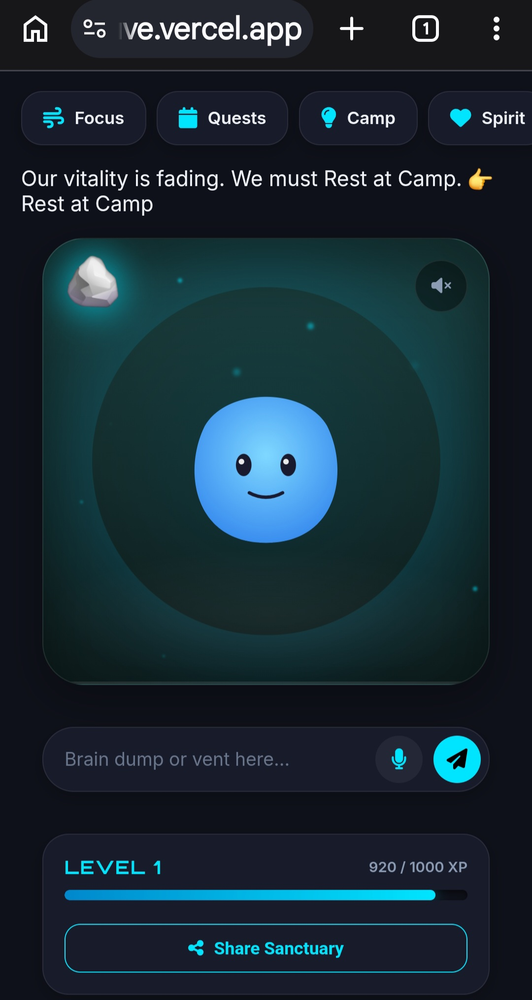
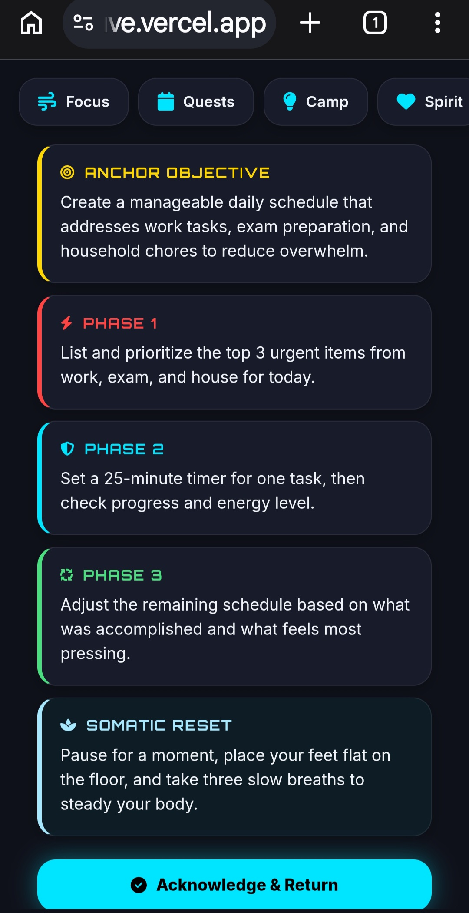
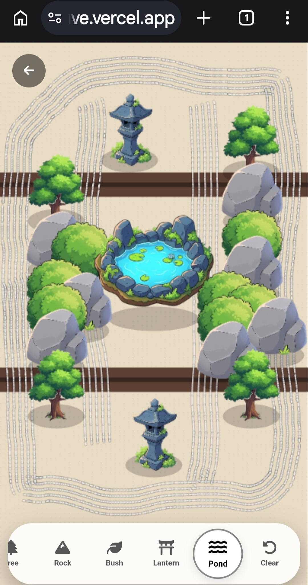

# 🌌 Vitverse
### *The Tamagotchi that won't let you doomscroll.*

**A gamified, AI-powered wellness app designed to stop burnout, make self-care fun, and build a genuine emotional connection with your habits.**

[](https://vitverse-mauve.vercel.app/)
[](https://vitverse-mauve.vercel.app/)
[]()

---

## 📸 Screenshots

*Click to expand*

| The Sanctuary (Home) | The AI Confidant | The Zen Sandbox |
|:---:|:---:|:---:|
|  |  |  |
| *A dynamic glowing companion whose Aura changes based on your real-life stats.* | *An emotionally intelligent AI that parses "brain dumps" into actionable game plans or empathy.* | *A spatial, Web Audio-powered Zen garden for active meditation.* |

---

## 🎯 Why Vitverse? (The Story)

Let's be honest: most wellness apps are either guilt-tripping streak trackers (like Habitica) or sterile meditation libraries (like Calm). 

**Vitverse is different.** It bridges the gap between emotional attachment and actual accountability. 

Instead of just tracking habits, you are taking care of a glowing digital Companion. If you neglect your mental health, the Companion starts to look tired and dim. It creates a sense of loss aversion—you actually want to take care of yourself so your Companion stays happy. 

### The 4 pillars of Vitverse:
1. **The "Forced Mechanic":** The Companion visually degrades if you ignore your self-care. It creates genuine accountability that standard habit trackers can't match.
2. **Instant, Glitch-Free UI:** We built a custom state engine that saves your progress locally first, so the app feels lightning fast (0ms latency) even on a weak connection.
3. **An AI That Actually Gets It:** Our backend uses xAI (Grok) to read your mood. If you need to vent, it acts as a caring Confidant. If you need a plan, it acts as a tactical coach. (It even includes built-in safety logic for self-harm detection).
4. **The Zen Sandbox:** When you are stressed, you can enter a Canvas-based garden, rake sand, and listen to procedurally generated Web Audio. It’s an ASMR-level distraction for panic attacks.

---

## ✨ Core Features

*   🫁 **BreatheWell:** Scientifically backed 4-7-8 and Box breathing protocols.
*   ✅ **ChronoZen:** A drag-and-drop task calendar that turns your chores into "Quests" that feed the Companion.
*   🌙 **Dreamweaver:** A sleep tracker with a reactive 3D moon that changes color based on how you slept.
*   ✨ **SoulSync:** A daily mood check-in that changes the app's background and gives you a private space to reflect.
*   🧠 **AI Tactician/Confidant:** A single input box that routes your thoughts to an LLM for either empathy or action.
*   🪨 **The Zen Sandbox:** A standalone interactive garden with generated audio.
*   🔗 **PWA & Offline First:** Install it on iOS/Android. It works completely offline and updates automatically.

---

## 🛠️ How It's Built (The Tech)

We built Vitverse with a "local-first" philosophy so it feels like a native app, backed by serverless cloud tech.

| Layer | Technology | Why we use it |
| :--- | :--- | :--- |
| **Frontend** | Vanilla JS, HTML, CSS | Zero dependencies. Blazing fast. |
| **State Engine** | Custom JS | Saves your XP and habits instantly to `localStorage`. |
| **Backend** | Vercel Serverless | Keeps our API keys hidden and secure. |
| **AI Engine** | xAI (Grok) | Strict JSON mode so the UI can render AI responses cleanly. |
| **Rate Limiting** | Upstash Redis | Protects our API wallet from bots. |
| **Database** | Supabase | Syncs your data across devices securely. |
| **Analytics** | PostHog | Tracks user retention and feature usage. |
| **Audio** | Web Audio API | Creates synthesized sounds on the fly (no heavy MP3 downloads). |

---

## 🚀 Business & Monetization

Vitverse is a fully functional MVP with a clear path to revenue:

*   **Freemium Model:** The core loop is free. The "Unlimited AI Plans," "Advanced Weekly Reports," and "Exclusive Companion Skins" can be gated behind a $4.99/month subscription.
*   **Native App Ready:** The app is built as a PWA and is ready to be wrapped via **Capacitor** for the Apple App Store and Google Play. This will allow push notifications (e.g., *"Your companion is wilting. Tap to restore"*).
*   **Target Audience:** High-stress professionals, students, and the ADHD community who struggle with traditional habit trackers.

---

## 💻 Running Locally

1. Clone the repository:
   ```bash
   git clone https://github.com/YOUR_USERNAME/vitverse.git
   cd vitverse
